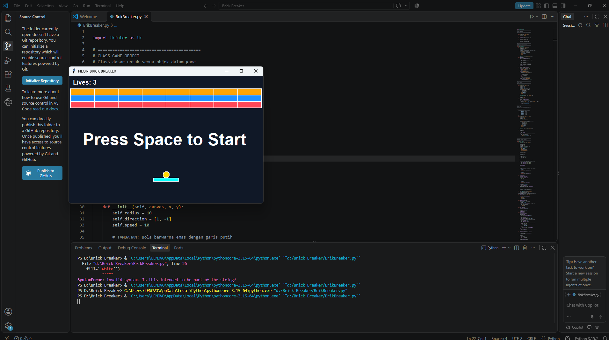

penjelasan :
1. Mengubah warna background
- bg='#101827' mengubah background menjadi biru gelap.
- width mengatur lebar permainan.
- height mengatur tinggi permainan.
- highlightthickness=0 menghilangkan garis tepi tambahan.
Hasil: Tampilan permainan menjadi lebih gelap dengan tema Neon Arcade.
2. Mengubah warna bola (Ball)
- create_oval() membuat objek berbentuk lingkaran.
- fill='#FFD700' memberikan warna emas pada bola.
- outline='white' memberikan garis tepi putih.
- width=2 mengatur ketebalan garis tepi.
Hasil: Bola berubah dari warna putih menjadi emas.
3. Mengubah warna paddle
- create_rectangle() membuat objek persegi panjang.
- fill='#00FFFF' mengubah warna paddle menjadi cyan.
- outline='white' menambahkan garis tepi putih.
- width=2 mengatur ketebalan garis.
Hasil: Paddle berubah dari kuning menjadi cyan.
4. Menambahkan variasi warna brick
Kode COLORS digunakan untuk menyimpan beberapa pilihan warna brick berdasarkan jumlah ketahanannya.
Angka	Warna
1	Merah
2	Biru
3	Oranye
4	Hijau
5	Ungu
6	Pink
Hasil: Brick memiliki variasi warna sehingga permainan terlihat lebih menarik.
5. Menambahkan garis tepi pada brick
- fill=color memberikan warna sesuai ketahanan brick.
- outline='white' memberikan garis tepi putih.
- width=2 mengatur ketebalan garis tepi.
- tags='brick' memberikan identitas pada objek agar mudah dideteksi oleh program.
Hasil: Brick memiliki warna dan garis tepi yang lebih jelas.
6. Menambahkan perubahan warna ketika brick terkena bola
- self.hits -= 1 mengurangi ketahanan brick setiap terkena bola.
- if self.hits <= 0 memeriksa apakah ketahanan brick sudah habis.
- self.delete() menghapus brick jika ketahanannya habis.
- itemconfig() mengubah warna brick sesuai sisa ketahanannya.
Hasil: Warna brick berubah setiap kali terkena bola dan akan hilang jika ketahanannya habis.
7. Mengubah jenis dan warna tulisan
- Arial mengubah jenis tulisan.
- size menentukan ukuran tulisan.
- bold membuat tulisan menjadi tebal.
- fill='white' mengubah warna tulisan menjadi putih.
Hasil: Tulisan lebih jelas dan mudah dibaca pada background gelap.
8. Menambahkan variasi jumlah ketahanan brick
- Baris pertama membuat brick dengan ketahanan 3.
- Baris kedua membuat brick dengan ketahanan 2.
- Baris ketiga membuat brick dengan ketahanan 1.
- for digunakan untuk membuat susunan brick secara berulang.
Hasil: Brick memiliki tingkat ketahanan yang berbeda sehingga permainan lebih bervariasi.
9. Mengubah judul aplikasi
root.title() digunakan untuk mengubah judul jendela aplikasi dari Hello, Jarvis! menjadi NEON BRICK BREAKER.
Hasil: Nama aplikasi menjadi sesuai dengan tema permainan.
10. Memperbaiki kondisi Game Over
- < 0 berarti permainan berakhir ketika nyawa kurang dari nol.
- <= 0 berarti permainan berakhir ketika nyawa mencapai nol atau kurang.
Hasil: Game Over akan muncul tepat ketika nyawa pemain habis.